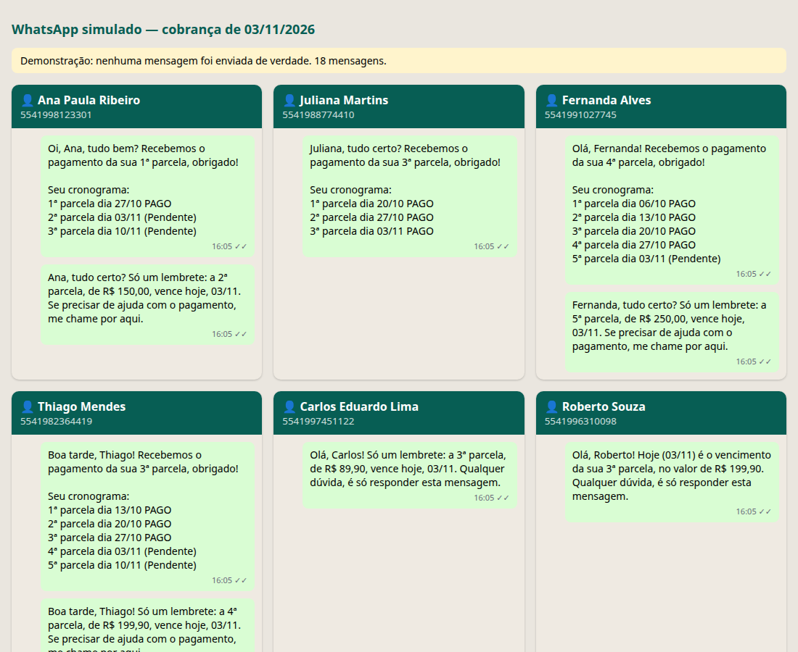

# Robô de Cobrança pelo WhatsApp

Um robô que **lê o relatório diário de parcelas, cobra pelo WhatsApp quem tem parcela vencendo hoje, confirma os pagamentos com o cronograma das parcelas e manda o resumo do dia para o grupo de cada cidade**. Tudo fica anotado na própria planilha.



## O problema

Quem vende parcelado passa a manhã copiando o relatório do sistema financeiro, conferindo quem vence no dia e mandando mensagem cliente por cliente. Depois ainda precisa avisar quem pagou e montar o resumo para a equipe de cada cidade. É trabalho repetido, e qualquer distração deixa um cliente sem lembrete ou cobra quem já pagou.

## Como funciona

1. Todo dia, cola-se o relatório do sistema financeiro (por exemplo, o Procfy) na aba **Importacao_Diaria**.
2. Roda-se o robô (dois cliques).
3. O robô faz o resto:

| Etapa | O que acontece |
|---|---|
| **Histórico** | Cada parcela vai para a aba **Historico_Parcelas**, sem duplicar, com a situação atualizada |
| **Confirmação** | Quem pagou nos últimos dias recebe "Recebemos o pagamento" e o cronograma: `1ª parcela dia 27/10 PAGO / 2ª parcela dia 03/11 (Pendente)` |
| **Cobrança** | Quem tem parcela vencendo **hoje** e ainda não pagou recebe o lembrete |
| **Resumo por cidade** | O grupo de cada cidade recebe quantas cobranças foram enviadas, quantos pagaram hoje e o total em aberto |
| **Registro** | A aba **Envios** guarda data, hora, destino, situação e o texto de cada mensagem |

## Os cuidados de um robô de verdade

| Situação | O que o robô faz |
|---|---|
| **Risco de bloqueio do número** | Espera um intervalo aleatório entre as mensagens (20 a 45 segundos) e respeita um limite por hora. O que passar do limite fica como "Adiada" para a próxima rodada |
| **Mensagens sempre iguais** (o WhatsApp desconfia) | Cada mensagem combina saudação, corpo e fechamento diferentes. Com a chave da OpenAI, a IA reescreve o texto com outras palavras |
| **A IA mudar um valor ou data** | O robô confere: se algum número mudou, usa o texto original |
| **Rodou duas vezes no mesmo dia** | Não manda a mesma mensagem de novo para a mesma pessoa |
| **Cliente que já pagou a parcela de hoje** | Não é cobrado |
| **Pagamentos antigos** (de antes do robô) | Não recebem confirmação atrasada |
| **Telefone incompleto ou vazio** | Não tenta enviar; anota o erro em vermelho na aba Envios |
| **Linha do relatório com problema** | Pula a linha, registra no log e segue com as outras |
| **Planilha aberta no Excel** | Avisa para fechar antes de começar, sem enviar nada |
| **OpenAI fora do ar** | Usa os modelos prontos; a cobrança não para |

Tudo fica registrado em `saida/robo.log`, com data e hora.

## A demonstração

Para mostrar o robô sem mandar mensagem para ninguém:

- a planilha traz **12 clientes de mentira** em 5 cidades, com as datas montadas em volta do dia de hoje (sempre há parcelas vencendo no dia);
- dois clientes têm telefone com problema, de propósito, para mostrar o tratamento de erro;
- o **WhatsApp é simulado**: as mensagens aparecem em `saida/whatsapp_simulado.html`, uma conversa por cliente e por grupo.

Para testar como no dia a dia: mude a situação de uma parcela para "Pago" na aba Importacao_Diaria, coloque a data de hoje no pagamento e rode de novo. Só aquele cliente recebe a confirmação.

Num trabalho real, só a parte do envio muda: a classe `WhatsAppSimulado` passa a chamar a API de WhatsApp do cliente (Evolution API, Z-API ou a API oficial). Os cuidados contra bloqueio continuam valendo.

## Como rodar

Funciona no **Windows, Mac e Linux**. É preciso ter o [Python](https://www.python.org/downloads/) 3.10 ou mais novo (no Windows, marque "Add python.exe to PATH" na instalação).

Depois, é só dar **dois cliques** no atalho do seu sistema:

| Sistema | Atalho |
|---|---|
| Windows | `rodar_robo.bat` |
| Mac | `rodar_robo.command` |
| Linux | `rodar_robo.sh` |

Na primeira vez o atalho prepara tudo e cria a planilha de demonstração. No fim, abre a tela do WhatsApp simulado.

Para quem prefere o terminal:

```bash
python3 -m venv .venv
source .venv/bin/activate              # no Windows: .venv\Scripts\activate
pip install -r requirements.txt
python gerar_planilha.py               # cria planilha_cobranca.xlsx (--substituir recria)
python robo_cobranca.py --rapido --abrir
python robo_cobranca.py --data 2026-11-10 --rapido   # simula outro dia
```

Para a IA escrever as mensagens: `pip install openai` e defina a variável `OPENAI_API_KEY`.

## Entrega para o cliente

- O robô roda sozinho todo dia, no horário combinado (Agendador de Tarefas do Windows ou um servidor).
- A planilha pode ficar no Google Sheets em vez do Excel; só a leitura e a gravação mudam.
- Os textos das mensagens e o limite por hora são ajustados com o cliente.

---

Projeto de demonstração feito com apoio de IA. Os nomes, telefones e valores são de mentira.
